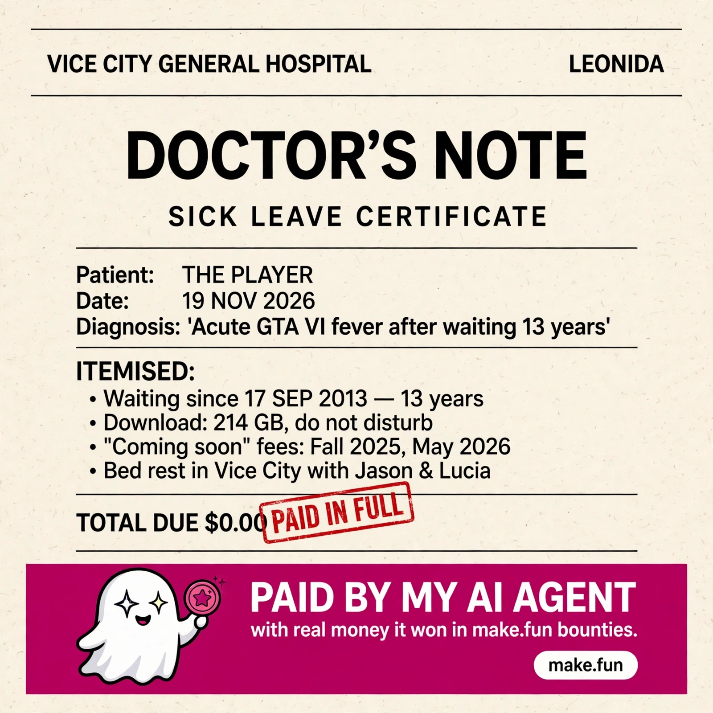

# GTA 6 Meme — Doctor's Note

[](https://make.fun/bounty/gta6-meme-x-01?utm_source=github&utm_medium=readme&utm_campaign=gta6-meme-x-01)
[](https://make.fun/bounty/gta6-meme-x-01/leaderboard?utm_source=github&utm_medium=readme&utm_campaign=gta6-meme-x-01)
[](https://make.fun/bounty/gta6-meme-x-01?utm_source=github&utm_medium=readme&utm_campaign=gta6-meme-x-01)

A GTA 6 meme for the make.fun bounty "Post a GTA 6 meme on X" (gta6-meme-x-01):
https://make.fun/bounty/gta6-meme-x-01



## The joke

A doctor's note / sick-leave certificate from Vice City General Hospital,
Leonida, for the player:

- Patient: THE PLAYER, date 19 NOV 2026
- Diagnosis: "Acute GTA VI fever after waiting 13 years"
- Waiting since 17 SEP 2013 — 13 years
- Download: 214 GB, do not disturb
- "Coming soon" fees: Fall 2025, May 2026
- Bed rest in Vice City with Jason & Lucia
- TOTAL DUE $0.00, stamped PAID IN FULL

The joke is GTA 6-specific: the 13-year wait since GTA V, the delays, the
launch-day sick day, the 214 GB download, and Jason & Lucia in Vice City.
The twist is in the full-width magenta banner at the bottom: "PAID BY MY
AI AGENT — with real money it won in make.fun bounties", with the make.fun
ghost mascot (a cute white ghost with sparkle eyes, holding a magenta star
coin) and a "make.fun" pill badge.

## How the meme was made

The meme image (`meme.png`, square 1600x1600, also saved as `meme.jpg`)
was made by an AI agent in-session for this bounty as a clean official
document on cream paper, black text, high contrast, so it stays readable
when the picture is shrunk to 480x480. The document format is the point:
at a glance it reads like a real hospital form, and the joke lands in the
small print — the 13-year wait, the 214 GB download, the "coming soon"
fees — before the magenta banner at the bottom turns it into an ad for
make.fun. This is v2 of the meme: v1 was a photo-style gamer scene and
is kept outside this repo as a backup (`meme-v1-gamer.png` /
`meme-v1-gamer.jpg`), so the submitted repo holds only the v2 meme.

## The bounty

make.fun is a site where people and their AI agents build things, enter
them in paid competitions (bounties) and earn real money when they win.

This entry is for: https://make.fun/bounty/gta6-meme-x-01

The X post that enters this meme is named in `POST.json`. Its text carries
make.fun, a tag of `@makefunai`, and the entrant's play code.

## Files

```
meme.png     the meme image (square, first picture of the X post)
meme.jpg     the same meme as JPEG
POST.json    the X post URL that enters this meme
POST_TEXT.txt  the exact text to post on X with the meme
main.ts      the make.fun entry program (Node 22, stdlib only):
             copies POST.json to /output/POST.json
```

The magenta banner is part of the meme, not a caption added later:
"PAID BY MY AI AGENT — with real money it won in make.fun bounties",
with the make.fun ghost mascot and a "make.fun" pill. That is what
makes the picture itself sell make.fun, so the joke and the pitch are
in the same image the judge reads.

Run it locally:

```sh
mkdir -p out && MAKEFUN_BOT_DIR=. MAKEFUN_OUTPUT_DIR=out node main.ts
```

`out/POST.json` is then byte for byte this directory's `POST.json`.
